  

# こんにちは、TakeRei です 👋

金沢工業大学 大学院 修士1年(2028年3月修了予定)です。**Unity / C# で VR・AR・MR コンテンツ**を開発しています。
「新しい技術(特に XR)で、人の心や行動を動かす体験をつくる」ことを目標に、企画から実装・改善まで一貫して取り組んでいます。

> [!NOTE]
> このアカウントは、これまでに制作してきた作品を就職活動用に整理して公開するため、2026年に新しく作成したものです。
> 制作自体は学部1年次(2022年)から続けており、コミット履歴は本アカウント作成以降のものになっています。

---

## 🔬 Research

**MR とプロジェクションマッピング(PM)を組み合わせた空間共有体験**

MR でしか見えない仮想的な存在を投影映像でも表現し、デバイスの装着者と非装着者が同じ空間で体験を共有できる手法の提案を目指しています。
MR 空間での操作とその結果を、PM でどう見せれば非装着者にも伝わるかを探究しています。

---

## 🛠 Skills

| 分野 | 技術 |
| --- | --- |
| 言語 | C#(最も得意) |
| ゲームエンジン | Unity |
| XR デバイス | HoloLens 2 / Meta Quest 3 / VIVE Focus 3 / Magic Leap 1 |
| 3D・空間スキャン | Blender / Matterport |
| 映像・インタラクティブ | TouchDesigner / Adobe After Effects / Adobe Photoshop |

---

## 💼 Experience

- **Microsoft Base Kanazawa**(KIT コーオプ教育プログラム・5か月)
- **株式会社スマートホテルソリューションズ** 長期インターン(2022年10月〜)
- **株式会社システムサポート** 長期インターン(2024年10月〜2025年3月)
- **学内インターン**(2022年5月〜)

---

## 🙋 About me

- 🏂 趣味:スノーボード
- 🏃 日課:ランニング
- 🦀 好きな食べ物:カニ味噌、ホルモン
