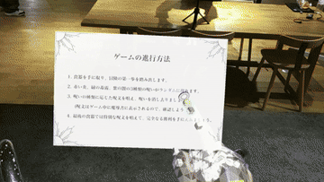

  

# こんにちは、竹澤麗加(TakeRei)です 👋

金沢工業大学 大学院 修士1年(2028年3月修了予定)。
**XR(特にMR)コンテンツ**と**プロジェクションマッピング**、2つの手法で「体験」をつくっています。

> 💡 **大切にしていること** 
> 体験する人の視点に立って「何が求められているのか」を考え、相手の思いを汲み取って、具体的な形にすること。

---

## 🎨 What I do

### 🥽 XR コンテンツ開発
Unity / C# ・ HoloLens 2 ・ Meta Quest

<table>
  <tr>
    <td width="50%"></td>
    <td width="50%"></td>
  </tr>
</table>

### 📽️ プロジェクションマッピング
After Effects ・ TouchDesigner

<table>
  <tr>
    <td width="50%" align="center"> 寺の鐘楼への投影</td>
    <td width="50%" align="center"> 商業施設の外壁への投影</td>
  </tr>
</table>

### 📸 制作・体験の様子

<table>
  <tr>
    <td width="25%" align="center"> HoloLens 2</td>
    <td width="25%" align="center"> VIVE Focus 3</td>
    <td width="25%" align="center"> 投影の準備</td>
    <td width="25%" align="center"> 本番のオペレーション</td>
  </tr>
</table>

---

## 🔬 Research ー MR × プロジェクションマッピング

  

MRでしか見えない存在を投影映像でも表現し、**ヘッドセットを着けていない人とも同じ体験を共有できる手法**を研究しています。

---

## 🛠 Skills

| 分野 | 技術 |
| --- | --- |
| 言語 | C#(最も得意) |
| ゲームエンジン | Unity |
| XR デバイス | HoloLens 2 / Meta Quest 2 / Meta Quest 3 / VIVE Focus 3 / Magic Leap 1 |
| 3D・空間スキャン | Blender / Matterport |
| 映像・インタラクティブ | TouchDesigner / Adobe After Effects / Adobe Photoshop |

---

## 💼 Experience

| 期間 | 内容 |
| --- | --- |
| 2022.05 〜 | 学内インターン |
| 2022.10 〜 | 株式会社スマートホテルソリューションズ 長期インターン |
| 2024.10 〜 2025.03 | 株式会社システムサポート 長期インターン |

---

※ このアカウントは、作品を就職活動用に整理して2026年に新しく作成したものです。制作は学部2年次(2023年)から続けています。
