

  

# こんにちは、竹澤麗加(TakeRei)です 👋
金沢工業大学 大学院 修士1年(2028年3月修了予定)です。XR(特にMR)コンテンツとプロジェクションマッピング（PM）の企画から実装・改善まで一貫して取り組んでいます。
> 💡 **大切にしていること** 
> 体験する人の視点に立って「何が求められているのか」を考え、相手の思いを汲み取って、具体的な形にすること。

## 🎨 What I do

### 🥽 XR コンテンツ開発
Unity / C# ・ HoloLens 2 ・ MetaQuest3 + mocopi

<table>
  <tr>
    <td width="33%" align="center">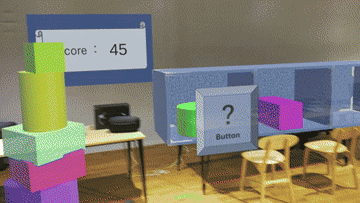 MR積み木の体験映像</td>
    <td width="33%" align="center">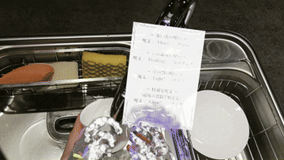 MR食器洗いの体験映像</td>
    <td width="33%" align="center">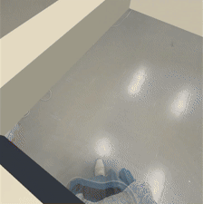 水に波紋が広がる体験映像</td>
  </tr>
</table>

### 📽️ プロジェクションマッピング（PM）
After Effects ・ Blender ・ TouchDesigner

<table>
  <tr>
    <td width="33%" align="center">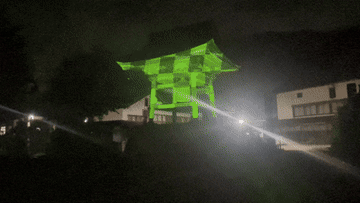 寺の鐘楼への投影</td>
    <td width="33%" align="center">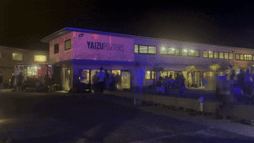 商業施設の外壁への投影</td>
    <td width="33%" align="center">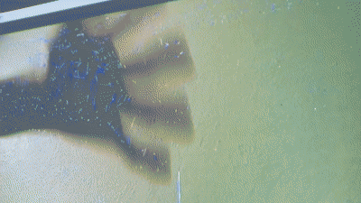 インタラクティブPM</td>
  </tr>
</table>

### 📸 制作・体験の様子

<table>
  <tr>
    <td width="25%" align="center">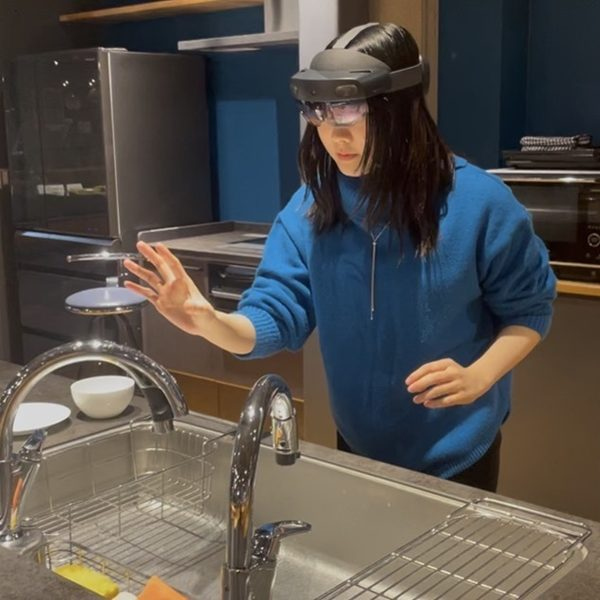 体験中の様子1(HoloLens 2)</td>
    <td width="25%" align="center">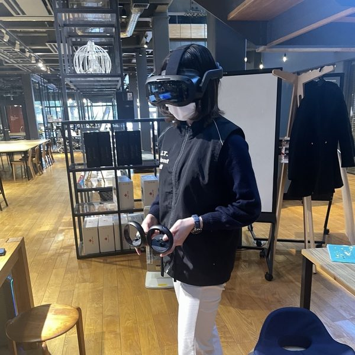 体験中の様子2(VIVE Focus 3)</td>
    <td width="25%" align="center">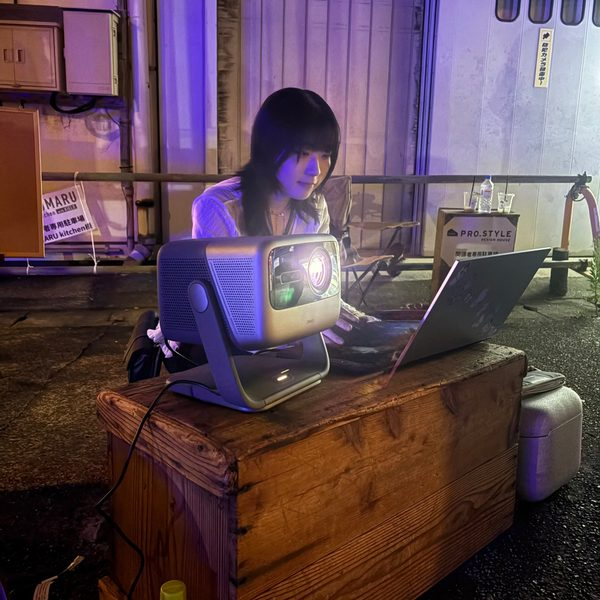 PM投影の準備</td>
    <td width="25%" align="center">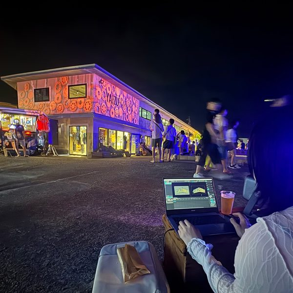 投影中の様子</td>
  </tr>
</table>

---

## 🔬 Research ー MR × プロジェクションマッピング

  

MR でしか見えない仮想オブジェクトを投影映像でも表現し、デバイスの装着者と非装着者が同じ空間で体験を共有できる手法の提案を目指しています。
MR 空間での操作とその結果を、PM でどう見せれば非装着者にも伝わるかを探究しています。

---

## 🛠 Skills

| 分野 | 技術 |
| --- | --- |
| 言語 | C#(最も得意) |
| ゲームエンジン | Unity |
| XR デバイス | HoloLens 2 / Meta Quest 2 / Meta Quest 3 / VIVE Focus 3 / Magic Leap 1 |
| 3D・空間スキャン | Blender / Matterport |
| 映像・インタラクティブ | TouchDesigner / Adobe After Effects / Adobe Photoshop |

---

## 💼 Experience

| 期間 | 内容 |
| --- | --- |
| 2022.05 〜 | 学内インターン |
| 2022.10 〜 | 株式会社スマートホテルソリューションズ 長期インターン |
| 2024.10 〜 2025.03 | 株式会社システムサポート 長期インターン |

---

※ このアカウントは、作品を就職活動用に整理して2026年に新しく作成したものです。制作は学部2年次(2023年)から続けています。
